# cra-sbom-check

cra-sbom-check lee SBOM en CycloneDX JSON e informa de lo que falta para que sean útiles bajo el Reglamento de Ciberresiliencia de la UE (que obliga a los fabricantes a documentar los componentes de un producto) y los elementos mínimos de NTIA: el propio producto, una marca de tiempo, quién generó el SBOM y, para cada componente, nombre, versión, proveedor, identificador único (purl o CPE), hash y licencia, además de las relaciones de dependencia y un contacto de seguridad.



**Demo en vivo:** https://jvch0512.github.io/cra-sbom-check/ (datos sintéticos)

## Uso

```bash
make build
bin/cra-sbom-check examples
bin/cra-sbom-check producto.cdx.json --tsv
bin/cra-sbom-check producto.cdx.json --fail-on high
```

Códigos de salida: 0 correcto, 1 hallazgos iguales o superiores a `--fail-on`, 2 entrada no válida. La salida es texto por defecto y TSV con `--tsv`; también hay SARIF mediante `scripts/tsv2sarif.py`.

| Regla | Severidad | Qué detecta |
|---|---|---|
| CRA001 | alta | sin `metadata.component` con nombre y versión: el producto no está identificado |
| CRA002 | media | sin `metadata.timestamp` |
| CRA003 | media | sin fabricante, proveedor o autor del SBOM en `metadata` |
| CRA004 | media | componente sin versión |
| CRA005 | media | componente sin `purl` ni `cpe` |
| CRA006 | baja | componente sin proveedor, editor o autor |
| CRA007 | baja | componente sin hash |
| CRA008 | media | más de un componente y sin grafo de dependencias |
| CRA009 | baja | componente sin información de licencia |
| CRA010 | media | sin referencia externa `security-contact` para notificar vulnerabilidades |
| CRA011 | baja | una dependencia apunta a un `bom-ref` que no existe |
| CRA000 | info | el fichero no es un documento CycloneDX JSON |

## Límites

- Comprueba que los campos estén completos, no que sean ciertos. No verifica purl ni hashes contra un registro.
- Solo lee CycloneDX JSON. Los documentos SPDX se informan como no CycloneDX.
- Se incluyen los componentes anidados dentro de otros componentes.
- Ayuda a preparar la documentación. No decide si un producto cumple el Reglamento de Ciberresiliencia.
- Contexto de fechas: las obligaciones de notificación del artículo 14 se aplican desde el 11 de septiembre de 2026 y el resto del Reglamento desde el 11 de diciembre de 2027.

## Dónde encaja

Comprobar SBOM antes de enviarlos a un cliente o a una autoridad de vigilancia del mercado, y como control de calidad de SBOM en CI.

## Pruebas

```bash
make test
```

## Más información

- Código abierto bajo licencia MIT. Seguridad: [SECURITY.md](SECURITY.md).
- Validación con datos reales: [docs/validation.md](docs/validation.md) (en inglés).
- Versión en inglés: [README.md](README.md).
