# cra-sbom-check

[Español](README.es.md)

cra-sbom-check reads CycloneDX JSON SBOMs and reports what is missing for them to be useful under the EU Cyber Resilience Act (which requires manufacturers to document the components of a product) and the NTIA minimum elements: the product itself, a timestamp, who produced the SBOM, and for each component a name, version, supplier, unique identifier (purl or CPE), hash and licence, plus the dependency relationships and a security contact.



**Live demo:** https://jvch0512.github.io/cra-sbom-check/ (Synthetic data.)

F# on .NET 8, no packages. The demo page is rendered from the tool's `--tsv` output by `scripts/site.py` (Python 3, only needed to regenerate the page).

## Use

```bash
make build
bin/cra-sbom-check examples
bin/cra-sbom-check product.cdx.json --tsv
bin/cra-sbom-check product.cdx.json --fail-on high       # exit 1 on any high finding
```

Exit codes: 0 ok, 1 findings at or above `--fail-on`, 2 bad input. Output is human text by default and TSV with `--tsv` (`# N files, M findings`, then `SEVERITY<TAB>RULE<TAB>WHERE<TAB>MESSAGE`).

| Rule | Severity | What it catches |
|---|---|---|
| CRA001 | high | no `metadata.component` with a name and version: the product is not identified |
| CRA002 | medium | no `metadata.timestamp` |
| CRA003 | medium | no manufacturer, supplier or author of the SBOM in `metadata` |
| CRA004 | medium | a component without a version |
| CRA005 | medium | a component with neither `purl` nor `cpe` |
| CRA006 | low | a component without supplier, publisher or author |
| CRA007 | low | a component without a hash |
| CRA008 | medium | more than one component and no dependency graph |
| CRA009 | low | a component without licence information |
| CRA010 | medium | no `security-contact` external reference for vulnerability reports |
| CRA011 | low | a dependency refers to a `bom-ref` that does not exist |
| CRA000 | info | the file is not a CycloneDX JSON document |

See [examples](examples) and [docs/sample-output.txt](docs/sample-output.txt).

## Limits

- It checks completeness of fields, not truth. A purl or a hash is not verified against a registry.
- Only CycloneDX JSON is read. SPDX documents are reported as not CycloneDX.
- Components nested inside other components are included.
- Dates: the Article 14 reporting obligations have applied since 11 September 2026 and the rest of the Cyber Resilience Act applies from 11 December 2027.
- This tool helps prepare documentation. It does not decide whether a product meets the Cyber Resilience Act.

## Where it fits

Pre-checking SBOMs before sending them to a customer or a market surveillance authority, and as a CI gate on SBOM quality.

## Tests

```bash
make test    # A .NET test program: every rule on good and bad SBOMs, nested components, dependency refs, hostile JSON, 3000-case fuzzing and CLI exit codes
```

MIT.

## Code scanning (SARIF)

`scripts/tsv2sarif.py` converts the `--tsv` output into SARIF 2.1.0, so findings show up in GitHub code scanning:

```sh
bin/cra-sbom-check examples --tsv | python3 scripts/tsv2sarif.py --tool cra-sbom-check --prefix examples > results.sarif
```

Upload `results.sarif` with `github/codeql-action/upload-sarif`. Severities map to SARIF levels (critical and high to error, medium to warning, low and info to note) and to a `security-severity` score.
